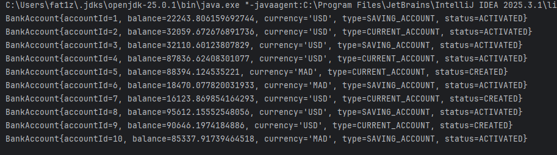
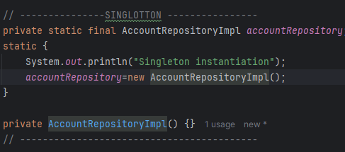
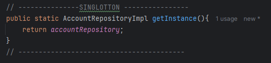
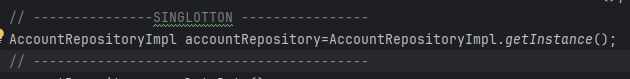
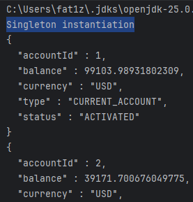
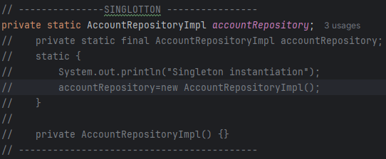
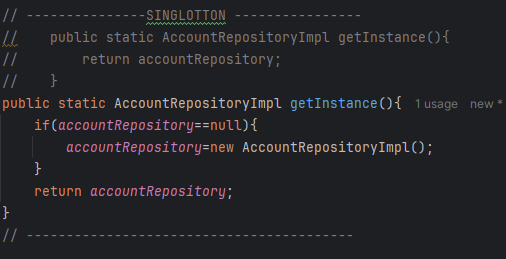
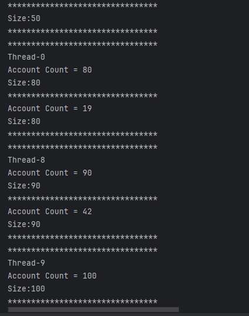

## BUILDER

### avec Json
ajouton la dependency
```
<dependencies>
        <dependency>
            <groupId>com.fasterxml.jackson.core</groupId>
            <artifactId>jackson-databind</artifactId>
            <version>2.14.1</version>
        </dependency>
    </dependencies>
```


## SINGLOTON
### avec block statique




### sans block statique


### test avec les threads
